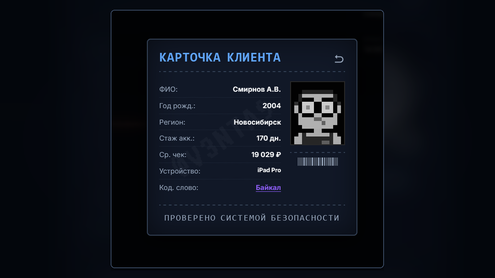
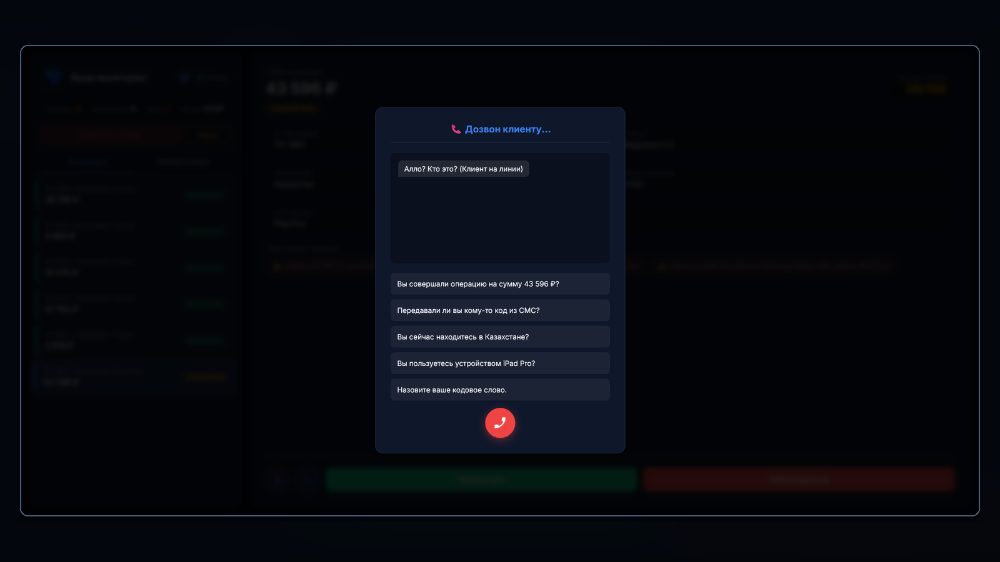
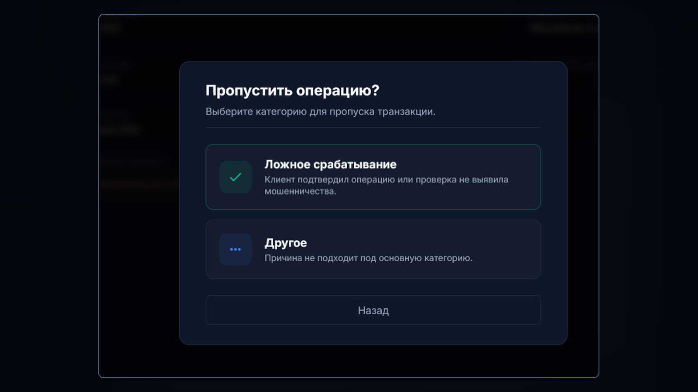
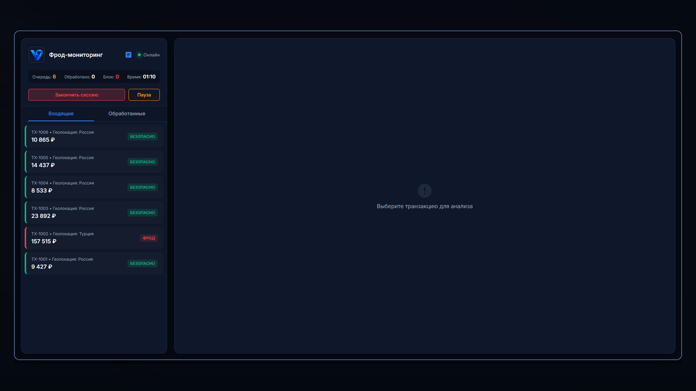

# 🛡️ Тренажер фрод-мониторинга (Fraud-Monitoring Simulator)

**Интерактивный веб-симулятор для отработки практических навыков выявления мошеннических операций и работы с транзакциями.**

Данный pet-проект был создан для демонстрации понимания процессов фрод-мониторинга, риск-менеджмента и клиентского верифицирования. Это тренажер, который симулирует работу аналитика в банковской сфере или платежной системе.

🔗 **[Посмотреть Live Demo](https://v3nta9.github.io/fraud-monitoring-simulator/)**

---

## 📖 Описание проекта
Вы выступаете в роли аналитика первой линии фрод-мониторинга. Система генерирует входящие транзакции, каждая из которых имеет свою оценку риска (Risk Score), сработавшие правила и профиль клиента.

**Ваша задача:** проанализировать данные, при необходимости связаться с клиентом, выявить признаки социальной инженерии и принять верное решение — пропустить операцию (если она легитимна) или заблокировать (если это фрод).

### 🌟 Ключевые бизнес-фичи
*   **Анализ транзакций (Rule-based system):** Симуляция срабатывания правил (аномально высокая сумма, ночное время, несовпадение геолокации, новый аккаунт, подозрительное устройство).
*   **KYC / Профиль клиента:** Сверка текущей операции с историческим профилем клиента (средний чек, домашний регион, основное устройство).
*   **Симулятор верификации (Звонки):** Отработка навыков телефонной проверки. Система имитирует диалог с честным клиентом (адекватные ответы) и с мошенником (ложь, агрессия, путаница в показаниях).
*   **Классификация инцидентов:** Оценка и разметка операций (Ложное срабатывание / Подтвержденное мошенничество).
*   **Метрики качества (Confusion Matrix):** По итогам сессии выводится отчет с расчетом:
    *   **TP (True Positive):** Поймано мошенников.
    *   **FP (False Positive):** Ложные срабатывания (заблокирован честный клиент).
    *   **FN (False Negative):** Пропущен фрод.
    *   **TN (True Negative):** Верно пропущено.
    *   *Общая точность решений и финансовый результат (спасенные/потерянные средства).*

---

## 🖼️ Скриншоты процесса

**1. Профиль клиента (Сверка данных и выявление аномалий):**

**2. Процесс верификации (Звонок клиенту):**

**3. Принятие решения (Классификация инцидента):**

**4. Общий вид тренажера:**

---

## ⚙️ Как это работает (Доменная логика)
В основе игры лежит генератор случайных событий, который распределяет транзакции по трем уровням риска:
1.  **Низкий риск (Low Risk):** Типичные операции (обычно пропускаются). Фрод встречается крайне редко.
2.  **Средний риск (Medium Risk):** Отклонения по сумме, геолокации или времени. Требует проверки профиля.
3.  **Высокий риск (High Risk):** Суммы > 100 000 ₽, ночное время, TOR-браузеры, новые аккаунты. Вероятность фрода — 85%.

**Особенность звонков:** Мошенники пытаются запутать аналитика. Если задать им более 3 вопросов, они начинают давить на жалость или угрожать жалобами. Если клиент утверждает, что он в России, а транзакция прошла в Нигерии — это либо VPN, либо взлом аккаунта.

---

## 🛠️ Техническая реализация (Кратко)
Проект реализован как одностраничное веб-приложение (SPA) без использования тяжелых фреймворков для быстрой загрузки.
*   **Стек:** HTML5, CSS3, Vanilla JavaScript (ES6+).
*   **Визуализация данных:** Генерация уникальных пиксельных аватаров (DiceBear API), стилизация под ретро-терминалы (шрифты VT323, Courier Prime).
*   **UI/UX:** Темная тема, всплывающие модальные окна, имитация интерфейса сканера документов.
*   **🤖 Использование ИИ:** Проект разработан с активным применением нейросетей (ChatGPT, DeepSeek) для генерации кода, настройки игровой логики, проработки текстовых сценариев и оформления интерфейса.

---

## 👨‍💻 Автор
**V3NTA9**
*   GitHub: [@V3NTA9](https://github.com/V3NTA9)
*   Email: [v3nta9@gmail.com](mailto:v3nta9@gmail.com)

---
*Дисклеймер: Данный проект является учебным симулятором и не содержит реальных банковских данных. Все транзакции, клиенты и устройства вымышлены. Приложение создано исключительно в демонстрационных целях. Кодовая база и тексты были сгенерированы при поддержке искусственного интеллекта.*
